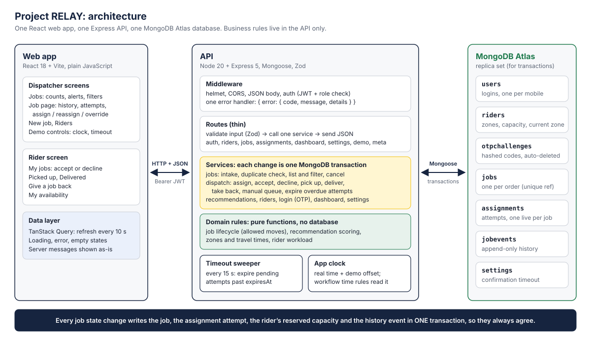
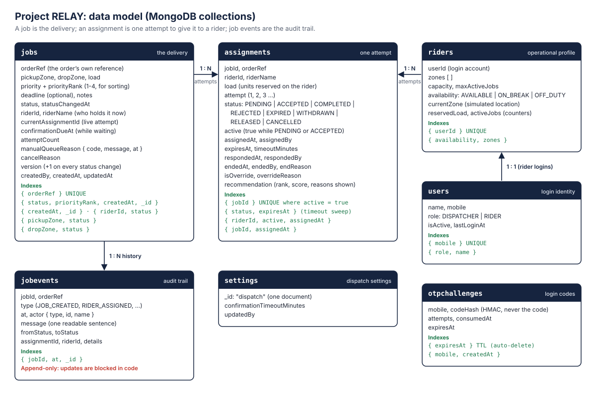

# RELAY: System design

RELAY is a dispatch desk for a delivery operation. Jobs enter the system, the desk ranks the riders who
can take each one, a dispatcher assigns a rider, the rider confirms, and the job moves through pickup to
delivery. A rider who does not confirm within the configured time (2 hours by default) loses the job
automatically: it moves to the **Manual Queue**, the rider's reserved capacity is released, and every step
stays in the job's history.

The system is deliberately small: one React web app, one Express API and one MongoDB Atlas database.
There is no message broker, cache or second service, because nothing at this size needs one. Section 10
explains what would change as volume grows.

**Where each question from the brief is answered**

| The brief asks about | Section |
|---|---|
| Architecture diagram, main components | [1](#1-architecture) |
| Relationships between jobs, riders, assignments and history | [2](#2-data-model) |
| Difference between a delivery job and an assignment attempt | [2.2](#22-job-vs-assignment-attempt) |
| How rider capacity is reserved and released | [4.2](#42-capacity-reservation-and-release) |
| Prevention of duplicate jobs and conflicting assignments | [7](#7-consistency-and-concurrency) |
| Efficient retrieval of operational queues and job history | [2.4](#24-indexes) |
| Consistency of status changes and assignment records | [7](#7-consistency-and-concurrency) |
| Assignment workflow | [4](#4-assignment-workflow) |
| Timeout handling | [6](#6-confirmation-timeout) |
| Important design decisions and trade-offs | [9](#9-key-decisions-and-trade-offs) |
| Future limitations and how to address them | [10](#10-limitations-and-how-it-would-grow) |

---

## 1. Architecture



| Component | Responsibility |
|---|---|
| **Web app** (React 18, Vite, TanStack Query) | Dispatcher screens (jobs dashboard, job page with dispatch panel and history, new job, riders, demo controls) and the rider screen (offers, pickup, delivery, availability). It holds no business rules: the buttons it shows come from the API (`nextStatuses`, recommendations, rider `workload`), and the messages it shows are the server's own. It refreshes data every 10 seconds. |
| **Middleware** | Security headers (helmet), CORS, JSON body limit (100 kB), JWT authentication, role checks, and one error handler that turns every failure into `{ "error": { "code", "message", "details" } }`. |
| **Routes** | Thin: validate the request with a Zod schema, call one service function, send the result. No business logic. |
| **Services** | The workflow: job intake and duplicate handling, assignment, accept/decline, pickup, delivery, take back, manual queue, cancellation, timeout expiry, riders, login, dashboard counts, settings. **Every workflow change runs in one MongoDB transaction** that covers the job, the assignment attempt, the rider's capacity and the history event. (Single-document changes, such as a rider's availability or the timeout setting, are atomic on their own.) |
| **Domain rules** | Pure functions with no database access: the job state machine (`jobLifecycle.js`), recommendation scoring (`recommendation.js`), zones and the travel-time table (`zones.js`), rider workload (`rider.js`). They are unit-tested on their own. |
| **Timeout sweeper** | A timer in the API process. Every 15 seconds it expires pending attempts whose confirmation time has passed (section 6). |
| **App clock** | Every workflow time rule (timestamps, deadlines, confirmation timeouts) reads `clock.now()` instead of `Date.now()`; login code and token expiry use real time. In normal use it is the real time; the demo controls can move it forward to show the 2-hour timeout without waiting. |
| **MongoDB Atlas** | Seven collections (section 2). Atlas is a replica set, which multi-document transactions need. The API refuses to start against a standalone server. |

**Request path, using "assign a rider" as the example**

1. `POST /api/jobs/ORD-1001/assignments` with `{ "riderId": "…", "overrideReason"?: "…" }` and a dispatcher's token.
2. Middleware checks the token and the DISPATCHER role. The route validates the body with Zod.
3. `dispatch.assignRider()` opens a transaction and:
   - reads the job and checks it can be assigned
   - recomputes the recommendations from current data
   - checks that the chosen rider is eligible, and requires a reason if they are not the top recommendation
   - reserves the rider's capacity with one conditional update
   - creates the assignment attempt
   - moves the job to `AWAITING_CONFIRMATION` with a status-and-version check
   - writes the history event.
4. The transaction commits, or nothing is written. Any rule that fails becomes a 409 or 422 with a readable message.

---

## 2. Data model



### 2.1 Collections

| Collection | One document is | Notes |
|---|---|---|
| `jobs` | one delivery | Identified by the order's own reference (`orderRef`, unique). Holds the current status and, while a rider holds it, who (`riderId`, `riderName`, `currentAssignmentId`). |
| `assignments` | one attempt to give a job to one rider | Every attempt is kept, including failed ones, with how and why it ended. |
| `jobevents` | one thing that happened to a job | The audit trail: type, time, actor, readable message, status change and details. Append-only. |
| `riders` | a rider's operational profile | Zones, capacity, job limit, availability, simulated location, and the counters `reservedLoad` and `activeJobs`. |
| `users` | a login account | Dispatchers and riders. One account per mobile number. A rider's `users` record is linked 1:1 to a `riders` record. |
| `settings` | the dispatch settings (a single document, `_id: "dispatch"`) | The confirmation timeout in minutes, changeable at runtime. |
| `otpchallenges` | one login code request | The code is stored only as an HMAC. Documents are deleted automatically after expiry (TTL index). |

### 2.2 Job vs. assignment attempt

A **job** is the delivery: what moves, from where to where, how urgently, and where it is in its
lifecycle. An **assignment** is one attempt to give that job to a rider. One job can have several
attempts: the first rider declines, the second does not answer, the third delivers. Keeping them apart
means:

- **Failed attempts stay on record** with their own status, times, actor and reason, and the job page can show "1. Karthik, no response; 2. Deepa, delivered".
- **"One live attempt per job" becomes a database rule** (a partial unique index, section 2.4) instead of an application check that two requests could both pass.
- **Ranking can use past attempts.** Riders who declined or dropped this job are excluded, and riders who did not answer lose 20 points.
- **Capacity belongs to the attempt.** The load reserved on a rider is held by the live attempt and released exactly once when that attempt ends.

| Attempt status | Meaning | `active` | Rider's capacity |
|---|---|---|---|
| `PENDING` | waiting for the rider to confirm | true | reserved |
| `ACCEPTED` | rider confirmed; job in progress | true | reserved |
| `COMPLETED` | delivered | false | released |
| `REJECTED` | rider declined | false | released |
| `EXPIRED` | no answer within the timeout | false | released |
| `WITHDRAWN` | a dispatcher took the job back | false | released |
| `RELEASED` | the rider gave back a job they had accepted | false | released |
| `CANCELLED` | the job was cancelled | false | released |

### 2.3 Embedded or separate

| Decision | Chosen | Why | Trade-off |
|---|---|---|---|
| Assignment attempts | separate collection | Many per job, queried across jobs (the sweeper's "pending and past `expiresAt`"), protected by their own unique index | One extra read on the job page |
| Job history | separate, append-only collection | Grows without limit, only ever appended and read in order; keeps the job document small and avoids every event contending on the job document | A second query for the history |
| Rider name and order reference | copied into jobs, attempts and events | Lists and history read without joins, and a record keeps the name it had at the time | A renamed rider keeps the old name on past records (intended for an audit trail) |
| Rider capacity | counters on the rider (`reservedLoad`, `activeJobs`) | Reservation is a single atomic conditional update (section 4.2) | The counters must change only in the same transaction as the attempt that owns them, and they do |
| Login vs. rider profile | two collections, created together in one transaction | Identity changes rarely; operational data changes all day | Two writes when adding a rider |
| Manual-queue reason | embedded in the job (`manualQueueReason { code, message, at }`) | Shown on every list and job page; one per job at a time | Earlier reasons live in the history, not on the job |

### 2.4 Indexes

Each index either protects a business rule or serves a frequent query.

| Collection | Index | Purpose |
|---|---|---|
| jobs | `{ orderRef: 1 }` **unique** | No duplicate jobs, even for two identical requests at the same moment |
| jobs | `{ status: 1, priorityRank: -1, createdAt: 1, _id: 1 }` | Operational queues: "jobs in status X, most urgent first, oldest first" (`_id` matches the list's tie-breaker, so the sort comes from the index) |
| jobs | `{ createdAt: -1, _id: -1 }` | Dashboard list, newest first (read backwards for oldest first) |
| jobs | `{ pickupZone: 1, status: 1 }`, `{ dropZone: 1, status: 1 }` | Zone filter (a zone matches pickup or drop) |
| jobs | `{ riderId: 1, status: 1 }` | A rider's jobs |
| assignments | `{ jobId: 1 }` **unique, partial: `active: true`** | At most one live attempt per job: no double assignment |
| assignments | `{ status: 1, expiresAt: 1 }` | The timeout sweep: pending attempts past their deadline |
| assignments | `{ riderId: 1, active: 1, assignedAt: -1 }` | A rider's current and recent attempts (rider screen) |
| assignments | `{ jobId: 1, assignedAt: 1 }` | A job's attempts in order (job page) |
| jobevents | `{ jobId: 1, at: 1, _id: 1 }` | A job's full history in order |
| riders | `{ userId: 1 }` **unique** | One rider profile per login |
| riders | `{ availability: 1, zones: 1 }` | "Available riders who cover zone X" (ready for filtering riders in the query; today the ranking loads all riders, see section 10) |
| users | `{ mobile: 1 }` **unique** | One account per mobile number across roles |
| users | `{ role: 1, name: 1 }` | Riders or dispatchers by name |
| otpchallenges | `{ mobile: 1, createdAt: -1 }` | The latest code for a number, at login |
| otpchallenges | `{ expiresAt: 1 }` **TTL** | Expired login codes are deleted automatically |

The server waits for every collection and index to exist before it accepts requests, because the
unique indexes are business rules, not just speed-ups.

---

## 3. Job lifecycle

```
NEW ──► READY_FOR_ASSIGNMENT ──► AWAITING_CONFIRMATION ──► ACCEPTED ──► PICKED_UP ──► DELIVERED
              │                          │                     │
              │ no eligible rider        │ timeout / decline / │ taken back / rider gives it back
              │                          │ taken back          │
              ▼                          ▼                     ▼
         MANUAL_QUEUE ◄──────────────────┴─────────────────────┘
              └── reassign ──► AWAITING_CONFIRMATION

CANCELLED: from any status before PICKED_UP.     DELIVERED and CANCELLED are final.
```

| From | Allowed next statuses |
|---|---|
| `NEW` | `READY_FOR_ASSIGNMENT`, `CANCELLED` |
| `READY_FOR_ASSIGNMENT` | `AWAITING_CONFIRMATION`, `MANUAL_QUEUE`, `CANCELLED` |
| `AWAITING_CONFIRMATION` | `ACCEPTED`, `MANUAL_QUEUE`, `CANCELLED` |
| `ACCEPTED` | `PICKED_UP`, `MANUAL_QUEUE`, `CANCELLED` |
| `PICKED_UP` | `DELIVERED` |
| `MANUAL_QUEUE` | `AWAITING_CONFIRMATION`, `CANCELLED` |
| `DELIVERED`, `CANCELLED` | none (final) |

- The table lives in one place (`domain/jobLifecycle.js`). Every status change goes through `changeJobStatus()`, which checks it first. Any other move returns **409 `INVALID_TRANSITION`** naming the allowed moves, for example "Cannot move job from READY_FOR_ASSIGNMENT to DELIVERED".
- **Refinements to the brief's lifecycle, and why:**
  - **`NEW` is kept but passed straight through at intake.** A future intake step (address checks, scheduled pickups) can hold jobs there without changing the lifecycle.
  - **Intake checks rider availability.** If no rider at all could take the job (too heavy, zone not covered, everyone off duty), the job goes straight to the Manual Queue with the reason, instead of sitting unseen in "Ready".
  - **Cancelling is not allowed after pickup.** The goods are with the rider and would need a return flow, which is out of scope.
  - **The Manual Queue can only go to reassignment or cancellation**, so a job there cannot skip ahead or silently return to "Ready".
- The job also carries `version`, incremented on every status change, and `statusChangedAt` (shown as "in status for 25 min").

---

## 4. Assignment workflow

### 4.1 Steps

| Action | Who | What happens, all in one transaction |
|---|---|---|
| **Assign** | dispatcher | Job must be `READY_FOR_ASSIGNMENT` or `MANUAL_QUEUE`. Recommendations are recomputed; the rider must be eligible now. Anyone but the top rider needs an override reason. Capacity is reserved; a `PENDING` attempt is created with `expiresAt = now + timeout`; job → `AWAITING_CONFIRMATION`; event `RIDER_ASSIGNED` or `RIDER_REASSIGNED`. The attempt keeps what the dispatcher saw: the chosen rider's rank, score and reasons, the top rider, and the top three. |
| **Accept** | the rider, or a dispatcher recording a phone call | Attempt must still be `PENDING` and not past `expiresAt` (if it is, it is expired on the spot and the answer is refused). Attempt → `ACCEPTED`; job → `ACCEPTED`. |
| **Decline** | rider or dispatcher | Attempt → `REJECTED` with the reason; capacity released; job → `MANUAL_QUEUE` (reason `RIDER_REJECTED`). That rider is not offered this job again. |
| **Pick up** | rider or dispatcher | Job `ACCEPTED` → `PICKED_UP`; the rider's simulated location becomes the pickup zone. |
| **Deliver** | rider or dispatcher | Job → `DELIVERED`; attempt → `COMPLETED`; capacity released; rider's location becomes the drop zone. |
| **Take back** | dispatcher (before pickup) | Attempt → `WITHDRAWN`; capacity released; job → `MANUAL_QUEUE` (reason `WITHDRAWN`). |
| **Give back** | rider (after accepting, before pickup) | Attempt → `RELEASED`; capacity released; job → `MANUAL_QUEUE` (reason `RIDER_RELEASED`). That rider is not offered this job again. |
| **Move to manual queue** | dispatcher (a ready job) | Job → `MANUAL_QUEUE` (reason `DISPATCHER_FLAGGED`). |
| **Cancel** | dispatcher (before pickup) | Live attempt (if any) → `CANCELLED` and capacity released; job → `CANCELLED` with the reason. |
| **Timeout** | system | Section 6. |

Riders can act only on their own attempts and on the job they hold (403 otherwise). Dispatchers can act on any job.

### 4.2 Capacity reservation and release

A rider has `capacity` (load units) and `maxActiveJobs`. The counters `reservedLoad` and `activeJobs`
say how much of that is in use.

**Reserve** (at assignment) is one conditional update. It only succeeds if, at that exact moment,
the rider is available, covers both zones, has room for the load and has a free job slot:

```js
Rider.findOneAndUpdate(
  { _id: riderId, availability: 'AVAILABLE', zones: { $all: [pickupZone, dropZone] },
    $expr: { $and: [ { $lte: [{ $add: ['$reservedLoad', load] }, '$capacity'] },
                     { $lt: ['$activeJobs', '$maxActiveJobs'] } ] } },
  { $inc: { reservedLoad: load, activeJobs: 1 } })
```

If it matches nothing, the assignment fails. Two jobs racing for a rider's last units cannot both
succeed. The loser usually hits a write conflict, is retried by the driver, and then finds the rider no
longer eligible (422 `RIDER_NOT_ELIGIBLE`); if the conditional update itself is what fails, the answer is
409 `RIDER_CAPACITY_CHANGED`.

**Release** happens when the attempt ends: delivered, declined, expired, taken back, given back or
cancelled. Ending the attempt is itself a conditional update (`status` must still be what was read, and
`active: true`), so the release runs at most once per attempt. The release subtracts with a floor of zero,
in case the data was ever edited by hand.

A dispatcher cannot lower a rider's capacity or job limit below what is currently reserved. That check is
part of the same update filter, so it is atomic too (409 `RIDER_LOAD_EXCEEDS_LIMIT`).

---

## 5. Rider recommendation

Implemented as a pure function, `recommendRiders({ job, riders, now, history })` in `server/src/domain/recommendation.js`.

**Step 1: eligibility.** A rider is not eligible if they are on break or off duty, don't cover the
pickup or the drop zone, lack free capacity for the load, are at their job limit, or declined or gave
back this same job earlier. Every excluded rider is returned with all of their reasons.

**Step 2: score from 0 to 100.** Each eligible rider gets four sub-scores between 0 and 1:

| Factor | Formula |
|---|---|
| travel | `(30 − minutes to pickup) ÷ (30 − 8)`, from the simulated zone-to-zone table (8–30 min) |
| workload | `1 − activeJobs ÷ maxActiveJobs` |
| deadline | slack = minutes to deadline − ETA, where ETA = to pickup + 5 min loading + pickup to drop; `slack ÷ 60`, between 0 and 1; no deadline = 1 |
| capacity | units free after this job ÷ capacity |

| Priority | travel | workload | deadline | capacity |
|---|---|---|---|---|
| Low, Normal | 0.40 | 0.25 | 0.20 | 0.15 |
| High, Urgent | 0.55 | 0.10 | 0.25 | 0.10 |

A rider who let this same job time out earlier stays eligible but loses 20 points, with a warning.
Ties go to the closer rider, then fewer jobs, then the name. Each rider comes with readable reasons
("8 min to pickup (closest)", "5 of 10 units free after this job"), warnings ("May miss the deadline
by about 12 min") and one sentence on why they rank above the next rider, built from the factor with the
largest weighted difference.

The dispatcher can choose any eligible rider. Choosing anyone but the top rider requires a reason,
which is saved on the attempt and in the history, together with the chosen rider's rank, score and reasons, the top rider and the top three.

**Why these choices.**
- **Travel weighs most** because it drives delivery time.
- **Workload and capacity are scored**, so work spreads across riders instead of always going to the nearest one.
- **Zones and capacity are hard rules**, because no score makes a rider able to carry a load they have no room for.
- **The weights are a reasoned starting point.** They would be tuned with real delivery data.

---

## 6. Confirmation timeout

**Requirement.** If the rider does not confirm within the threshold (default 2 hours, configurable),
the job must move to the Manual Queue automatically, with the reason recorded, the expired attempt kept,
the capacity released and the job available for another attempt.

**Design.**

1. At assignment, the attempt stores its own `expiresAt` and `timeoutMinutes`. Changing the setting later does not change the time already given to a waiting rider.
2. Every 15 seconds the **sweeper** queries `{ status: 'PENDING', expiresAt: { $lte: now } }` using the `{ status, expiresAt }` index.
3. For each result it runs one transaction:
   - attempt `PENDING` → `EXPIRED`, a conditional update that does nothing if the attempt was answered meanwhile
   - release the rider's capacity
   - job → `MANUAL_QUEUE` with reason `CONFIRMATION_TIMEOUT`
   - two history events written by the System actor: `ASSIGNMENT_EXPIRED` and `MOVED_TO_MANUAL_QUEUE`.
4. **Rider answers after the deadline but before the next sweep:** the answer is refused (409 `ASSIGNMENT_EXPIRED`) and the attempt is expired on the spot. The rider sees "Too late: the 120-minute window to confirm has passed". If the sweep got there first, the answer is refused with 409 `ASSIGNMENT_NOT_PENDING` ("This assignment has expired…").
5. **Dispatcher takes back or cancels an overdue attempt:** it is recorded as expired first, so the missed confirmation is never hidden. The take-back then reports the timeout (409 `ASSIGNMENT_EXPIRED`, the job is already in the Manual Queue); a cancel goes ahead.
6. **Restart:** the sweeper also runs once at startup. All state is in the database, so anything that became due while the server was down is handled straight away (up to 100 attempts per sweep; any more on the following sweeps).

**Why a polling sweeper.**
- **A MongoDB TTL index only deletes documents.** It cannot run business logic.
- **An in-memory `setTimeout` per assignment is lost on restart** and does not work across several instances.
- **A job queue (BullMQ, Agenda) adds Redis or another moving part** that a desk this size does not need.
- **The polling sweeper is simple, restart-safe and correct with several instances.** Each expiry is conditional, so two sweepers cannot expire the same attempt twice. The cost is that a job can move up to one interval (15 s) late, which is fine against a 2-hour threshold.

**Testing it without waiting.** The confirmation timeout can be changed in the app (1 to 1440 minutes).
In non-production environments, dispatchers also have demo controls:
- move the app clock forward 15 min, 1 h or 2 h; every time rule follows the moved clock, and a timeout check runs immediately
- run the timeout check on demand.

---

## 7. Consistency and concurrency

**Base rule:** every workflow change is one MongoDB transaction covering the job, the attempt, the rider's
counters and the history events, so they never disagree. Changes to a single document (a rider's
availability, the timeout setting, login codes) are atomic without one. On top of that, each risky case has a guard
that the database enforces:

| Risk | Example | Guard | What the user sees |
|---|---|---|---|
| Duplicate job | An order is submitted twice, or a request is retried after a timeout | Unique index on `jobs.orderRef`; the service returns the existing job when the details match | 201 the first time; 200 with `Idempotent-Replayed: true` after; 409 `ORDER_REF_CONFLICT` listing the differences if the details differ |
| Two dispatchers assign one job | Both click Assign within a second | The job update requires the `status` and `version` that were read; the unique partial index allows one live attempt per job | The second gets 409 "ORD-1001 is already assigned to Ravi Kumar…" (or `JOB_ALREADY_ASSIGNED`) |
| Two jobs take a rider's last capacity | Two dispatchers assign different jobs to one rider | Conditional capacity update (section 4.2) | The second is refused: 422 `RIDER_NOT_ELIGIBLE` ("Needs 5 units free; has 2") or 409 `RIDER_CAPACITY_CHANGED` |
| Accept races the timeout | A rider accepts in the same second the sweeper runs | Both change the attempt only if it is still `PENDING`; exactly one wins | Either accepted, or a message that the time to confirm has passed |
| Rider declines while the dispatcher takes the job back | Both act on the same attempt | Same conditional update on the attempt | The second gets "The dispatcher has withdrawn this assignment" or "has no rider to take it back from" |
| Capacity released twice | Two end events for one attempt | Release happens only after the conditional update that ends the attempt succeeded | Not possible |
| History disagrees with the job | A crash between two writes | Events are written in the same transaction | Not possible |
| Invalid order of steps | Deliver before pickup; continue a cancelled job | State machine check in `changeJobStatus()` | 409 `INVALID_TRANSITION` |

**How simultaneous transactions resolve.** When two transactions write the same document, MongoDB
aborts one with a write conflict. The driver's `withTransaction` retries it automatically. On the retry,
it reads the new state and fails with the proper business error: "already assigned", "no longer
pending", and so on. Every transaction body is written to be safe to run more than once.

**Retried requests.**
- Job creation is idempotent by order reference.
- Other actions are protected by the state machine: a repeated "pick up" or "accept" cannot apply twice, and the repeat gets a 409 saying the job already moved. A full `Idempotency-Key` header, which would return the original response instead of the 409, is listed as a next step.

---

## 8. Security and validation

- **Login:** mobile number + one-time code.
  - The demo uses a fixed code (1234) through a provider interface (`otp.provider.js`); an SMS provider can be added without touching the auth service.
  - The fixed code is accepted in every environment. A real deployment must plug in an SMS provider first.
  - Codes are stored as an HMAC, never in plain text. They expire after 5 minutes, can be used once, and allow 5 attempts.
  - Requesting a code gives the same answer for registered and unknown numbers, so the API cannot be used to discover accounts.
- **Sessions:** JWT (HS256), 12-hour expiry, carrying the user id, role and rider id. Inactive accounts are refused on every request.
- **Authorisation:** routes declare the role they need. Rider endpoints also check ownership: a rider can open only the jobs linked to them (the one they hold, or one they delivered), with that job's attempts and history, and can act only on their own attempts.
- **Validation:** every body, query and path parameter goes through a Zod schema that trims, upper-cases order references, normalises Indian mobile numbers and rejects invalid values (unknown fields are dropped). Errors list every problem at once (`details: [{ path, message }]`).
- **Errors:** one handler, one shape, stable codes. Unexpected errors are logged and returned as a generic 500 without internals.
- **HTTP hardening:** helmet headers, a CORS allow-list from configuration, a 100 kB body limit.

---

## 9. Key decisions and trade-offs

| Decision | Alternative | Why this one |
|---|---|---|
| MongoDB with multi-document transactions | Postgres with row locks | The brief names MERN. Transactions on a replica set give the same all-or-nothing behaviour; unique and partial indexes plus conditional updates cover the races. |
| Separate `assignments` collection | Attempts as an array inside the job | Database-enforced "one live attempt", cross-job sweeper query, full attempt history |
| Counters on the rider for capacity | Summing live attempts on every check | One atomic conditional update makes over-booking impossible |
| Polling sweeper every 15 s | TTL index, `setTimeout`, Redis queue | Restart-safe and multi-instance safe, with nothing new to run; up to 15 s late is acceptable |
| App clock with a demo offset | Waiting 2 real hours, or editing data | The reviewer can watch a real timeout run through the real code path |
| Web app polls every 10 s | WebSockets / Socket.io | Enough for a desk of this size, with no extra infrastructure; push is a next step |
| Thin routes, rules in services and pure domain functions | Logic in handlers | Rules are readable and unit-testable on their own, as the brief asks |
| Declining excludes the rider from that job | Allow re-offering | Respects the rider's answer; re-offering with a reason is a listed improvement |

---

## 10. Limitations and how it would grow

| Area | Today | As volume grows |
|---|---|---|
| Live updates | Screens poll every 10 s | MongoDB change streams pushed over WebSockets or Server-Sent Events |
| Timeout sweeper | Runs in every API instance (safe, but duplicate work) | One worker process, or a leader lock; a delayed-job queue at very high volume |
| Recommendations | Loads all riders for each request (fine for hundreds) | Filter in the query with the `{ availability, zones }` index; real GPS with a `2dsphere` index and `$geoNear`; cache travel times |
| Locations | Zones and a fixed travel-time table | Real coordinates and a routing service for travel estimates |
| Lists | Offset pagination (`page`, `limit`) | Cursor pagination on `(createdAt, _id)` |
| History | Grows forever in `jobevents` | Archive old events to cold storage; keep recent months hot |
| Multiple cities | One pool of riders and zones | Partition riders and jobs by city or region; shard on that key |
| Assignment | Dispatcher assigns every job | Auto-offer to the top rider, with dispatchers handling exceptions |
| Login | Fixed demo code | SMS provider, rate limiting per number and IP |
| Retries | State machine refuses repeats with 409 | `Idempotency-Key` for every POST |
| Audit of rider edits | Rider profile changes are not in a history | A rider events collection, like `jobevents` |

---

## 11. Testing

- **Unit tests** (no database): the state machine, the recommendation rules and ranking explanations, zones, rider workload, mobile number normalisation, schemas, tokens, the clock.
- **Integration tests** (Supertest against the real app with an in-memory MongoDB replica set, or a separate Atlas test database):
  - the full HTTP flow, including the brief's eight required scenarios (marked `[1]`–`[6]` and `[8]` in `tests/integration/dispatch.test.js`; scenario 7, duplicate submission, is in `tests/integration/jobs.test.js`)
  - races: two dispatchers assigning one job, two jobs competing for a rider's last capacity, accept against the timeout check.
- Run with `npm test` in `server`. See the README for details.
